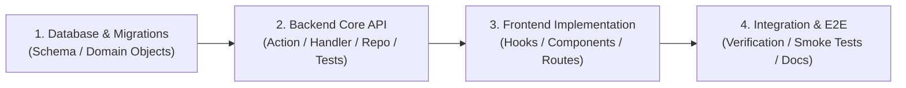

# Team Workflow & Engineering Guidelines

This document outlines team conventions, branch strategies, code standards, and PR requirements for our team of 4 building the **Hyperlocal Event Discovery & Community Engagement** platform.

---

## 1. Branch Strategy & Naming

Every feature, bug fix, or documentation update must be developed on an isolated branch created from latest `main`.

### Naming Pattern
```
phase<N>/<area>-<short-description>
```

### Examples
- `phase0/env-setup`
- `phase0/seed-data`
- `phase0/docs-contract`
- `phase1/backend-discover-api`
- `phase1/frontend-discover-feed`
- `phase1/frontend-map-view`
- `phase2/attendee-profiles`

---

## 2. Codebase Ownership & Folder Boundaries

To avoid merge conflicts between the 4 team members working in parallel:

| Team Role | Allowed Directories | Responsibilities |
|---|---|---|
| **Backend Engineers (x2)** | `backend/app/`<br>`backend/routes/`<br>`backend/database/`<br>`backend/tests/` | Route actions, domain handlers, repositories, migrations, and unit tests. |
| **Frontend Engineers (x2)** | `frontend/src/components/`<br>`frontend/src/queries/`<br>`frontend/src/mutations/`<br>`frontend/src/api/`<br>`frontend/src/styles/` | React components, discovery pages, map integrations, and styling. |
| **Data & Seed Lead** | `backend/app/Console/Commands/Hyperlocal/`<br>`backend/tests/Unit/Console/Hyperlocal/` | Seeding commands, coordinates, and mock data generators. |
| **Team Wide** | `docs/hackathon/` | Architecture specs, API contracts, setup guides, and logs. |

> **Rule:** Never modify files outside your assigned area without prior team agreement. Shared database migrations and route additions must be reviewed by both backend and frontend owners before merging.

---

## 3. Commit Message Convention

We adhere to the [Conventional Commits](https://www.conventionalcommits.org/) specification:

```
<type>(<scope>): <short imperative description>
```

### Types
- `feat`: A new user-facing feature or API endpoint.
- `fix`: A bug fix.
- `docs`: Documentation changes (`docs/hackathon/*` or markdown files).
- `test`: Adding or updating unit tests.
- `refactor`: Code refactoring that neither fixes a bug nor adds a feature.
- `style`: Formatting, missing semi-colons, Pint lint fixes (no production code changes).

### Examples
- `feat(discover): add public nearby events discovery endpoint with Haversine distance`
- `feat(frontend): implement discovery feed cards with category tags and distance badge`
- `docs(contract): define GET /api/events/discover schema and validation rules`
- `test(seed): assert all 24 categories covered and coordinates inside Mumbai bounds`

---

## 4. Pre-Merge PR Checklist

Before opening a PR or merging into `main`, run and verify each of the following:

- [ ] **Backend Code Style:**
  ```bash
  docker compose -f docker/development/docker-compose.dev.yml exec backend ./vendor/bin/pint --test
  ```
  Must pass with **zero** style violations.
- [ ] **Backend Unit Tests:**
  ```bash
  docker compose -f docker/development/docker-compose.dev.yml exec -T backend php -d memory_limit=1G vendor/bin/phpunit --no-coverage --testsuite=Unit
  ```
  All unit tests must pass with zero failures.
- [ ] **Frontend Type Check:**
  ```bash
  cd frontend && npx tsc --noEmit
  ```
  Must produce no new TypeScript errors.
- [ ] **API Reference Export (if API routes or resources changed):**
  ```bash
  docker compose -f docker/development/docker-compose.dev.yml exec backend php artisan api-reference:export
  ```
  Keep committed OpenAPI reference in sync with code.
- [ ] **Frontend Translations:**
  ```bash
  cd frontend && yarn messages:extract
  ```
  All new user-facing strings must be wrapped in `__()` (backend) or Lingui `t`/`<Trans>` (frontend) and translated into supported locales.
- [ ] **No Explanatory Comments:**
  Per [`AGENTS.md`](file:///AGENTS.md), delete all explanatory and "why" comments in code you touch. Rename or extract functions instead.
- [ ] **No Edits to Generated Domain Objects:**
  Never hand-edit files under `backend/app/DomainObjects/Generated/`. Run `php artisan generate-domain-objects` after schema changes.

---

## 5. Licensing & Attribution Rules

1. **Hi.Events Attribution (AGPL-3):**
   - The root `LICENCE` requires the **"Powered by Hi.Events"** attribution on all web pages and emails.
   - Do **NOT** remove, hide, or alter the "Powered by" footer or badge.
   - If anyone asks to strip or hide Hi.Events branding, inform them this requires a commercial licence and direct them to [https://hi.events/licensing](https://hi.events/licensing).
2. **Enterprise Features Gate (`ee/`):**
   - Reserved seating, box office, and enterprise SSO (`ee/`) are commercial features requiring a paid licence.
   - Do **NOT** touch anything under `ee/` or attempt to bypass licensing checks.

---

## 6. PR Merge Order Per Phase

To ensure unblocked, linear progression throughout the hackathon:



1. **Step 1: Database & Schema PR:** Land new tables, columns, migrations, and generated domain objects first.
2. **Step 2: Backend API PR:** Land endpoints, request validation, domain handlers, and unit tests adhering to [`docs/hackathon/API_CONTRACT.md`](file:///docs/hackathon/API_CONTRACT.md).
3. **Step 3: Frontend PR:** Build client queries, mutations, discovery pages, and UI components against the verified API contract.
4. **Step 4: Integration PR:** Run E2E specs, smoke tests, update documentation, and verify deployment on `main`.
